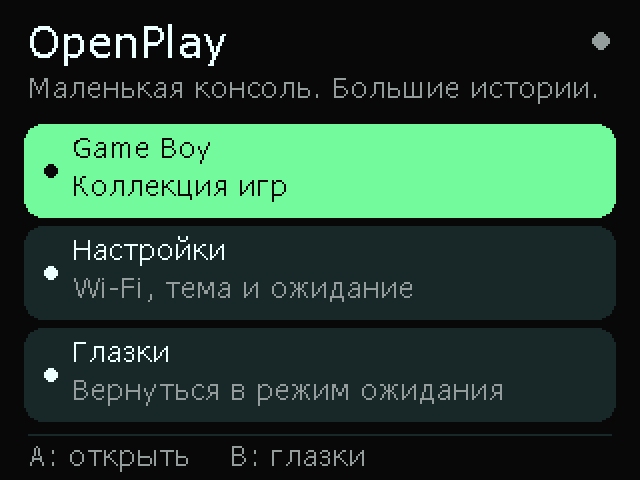

# OpenPlay OS 0.1

Наша мини-консоль на **AI-S3 / ESP32-S3 N16R8**: глазки в ожидании, свои Lua-программы, настройки и Game Boy. Это оболочка собственной прошивки поверх Arduino / FreeRTOS. Игры и программы робота на Lua запускаются из `.opd` со своим API OpenPlay. Совместимость с Playdate SDK и `.pdx` пока не реализована.



Снимок ранней версии меню; теперь также есть раздел «Lua-программы».

## Что уже есть

- При включении появляются глазки: моргают и переводят взгляд.
- A, B или нажатие джойстика открывают главное меню. Первое нажатие только будит консоль.
- В главном меню: Game Boy, Lua-программы, Настройки и Глазки.
- Три темы: солнечная, мятная и сиреневая; тема сохраняется после перезагрузки.
- Возврат к глазкам после 30 секунд, 1 минуты, 2 минут или вручную. В игре, паузе и при настройке с телефона таймер не действует.
- Wi-Fi 2,4 ГГц: настройка с телефона, включение/выключение, забыть сеть. Пароль и имя сети сохраняются в NVS.
- Загрузка `.gb` через браузер во внутреннюю Flash; SD-карта не требуется.
- Peanut-GB: запуск обычного Game Boy, меню паузы, START/SELECT, сохранение RAM картриджа.
- Lua 5.4.9: бандлы `.opd`, Lua-модули и ассеты, графика 320×240, ввод, жизненный цикл, GPIO/UART1 для программ робота. [API и примеры](docs/lua-api.md).

Глазки — это режим ожидания интерфейса: экран и процессор продолжают работать. Глубокий сон не используется.

## Управление

| Где | Джойстик | A | B | Нажатие джойстика |
| --- | --- | --- | --- | --- |
| Глазки | Двигает взгляд | Главное меню | Главное меню | Главное меню |
| Меню | Листает, при удержании повторяет | Выбрать | Назад; на главном экране — глазки | Выбрать |
| Игра | Крестовина | Game Boy A | Game Boy B | Короткое — START, удержание 0,7 с — пауза |
| Пауза | Выбор действия | Продолжить / START / SELECT / сохранить и выйти | Продолжить | Выбрать |
| Lua-программа | Доступен программе | Доступна программе | Доступна программе | Удержание 0,7 с — системная пауза |

После перехода между экранами нужно отпустить кнопки. Настройки темы и времени ожидания меняются нажатием A на соответствующей строке.

## Свои программы на Lua

Для разработки на компьютере есть **OpenPlay Studio** — IDE на Electron с
редактором, запуском Lua-программ в симуляторе 320×240 и сборкой `.opd`.
Открой `Start-OpenPlay-Studio.cmd` или смотри [инструкцию](ide/README.md).
Если компьютер и консоль подключены к одной локальной сети, кнопка
**Собрать и отправить (F6)** находит устройство, загружает программу и сразу
запускает её. Для этого нужна обновлённая прошивка из этого репозитория;
приём включается автоматически после подключения Wi-Fi.

```powershell
python tools/opd.py pack examples/bouncing-ball .pio/examples/bouncing-ball.opd
python tools/opd.py pack examples/robot-ports .pio/examples/robot-ports.opd
```

Открой **Lua-программы → Добавить программу**, подключись к Wi-Fi консоли и загрузи `.opd` через раздел Lua на `http://192.168.4.1/`. Нажми B и выбери программу. В бандле — JSON-манифест, Lua-файлы и ассеты; размер до 2 МиБ. Удержание джойстика открывает системную паузу. Порты робота задаются в манифесте и освобождаются при паузе, выходе и Lua-ошибке.

[Полное описание API 1](docs/lua-api.md) содержит формат `.opd`, манифест, графику, кнопки, модули, изображения, GPIO/UART и ограничения. Пример `bouncing-ball` — игра с шариком; `robot-ports` — GPIO16 и UART1 TX17/RX18. Упаковщик использует только стандартную библиотеку Python. Это первый API OpenPlay; сохранения Lua, звук и запуск существующих игр Playdate пока не реализованы.

## Подключение Wi-Fi

1. Открой **Настройки → Wi-Fi → Настроить с телефона**.
2. Подключи телефон к сети `OpenPlay-XXXX`. Пароль показан на экране; он создаётся заново при запуске консоли.
3. Открой **http://192.168.4.1/**. Если телефон сообщает, что у сети нет Интернета, останься подключённым к ней.
4. Введи название домашней сети 2,4 ГГц и пароль. Результат подключения появится на экране консоли; на попытку отводится 20 секунд.
5. Нажми B на консоли, чтобы закрыть настройку и отключить её точку доступа. Подключение к домашней сети сохраняется.

Точка доступа включается только по запросу из меню. Она защищена WPA2; домашний пароль не выводится на страницу или в журнал. Пароли хранятся в обычной NVS прошивки, без шифрования Flash. Кнопка «Забыть сеть» удаляет сохранённые учётные данные сразу.

## Игры Game Boy

1. **Game Boy → Добавить игры** открывает ту же точку доступа.
2. Подключись с телефона, открой **http://192.168.4.1/** и загрузи `.gb`. Имя файла — латиницей, цифрами, `-` или `_`; размер — до **2 МБ**.
3. Дождись сообщения о завершении. Нажми B на консоли и выбери игру из списка.
4. Для выхода удерживай джойстик, затем выбери **Сохранить и выйти**.

RAM картриджа сохраняется при паузе/выходе и каждые 30 секунд при изменениях. Это обычное внутриигровое сохранение; сохранений полного состояния эмулятора пока нет. Перед отключением питания выйди через меню паузы. RTC и его ход при выключенном устройстве пока не сохраняются.

Текущие ограничения:

- Обычный Game Boy / DMG. Game Boy Color и Game Boy Advance пока не поддерживаются. Картриджи, совместимые с DMG, могут работать в монохромном режиме.
- Без звука; аудиовыход на текущей сборке не подключён.
- Изображение 160×144 увеличивается до **266×240** на всю высоту экрана, без обрезки и с сохранением пропорций (округление до целого пикселя). По бокам остаются поля по 27 пикселей. Масштабирование ближайшим соседом сохраняет чёткие края пикселей. Вывод на ядре 0 использует три исходных буфера, небольшие буферы полос и обновление только изменившихся областей. Эмуляция продолжает работать независимо от SPI. По умолчанию — обычная передача SPI на **10 МГц, без DMA**. Ускоренный вывод 40 МГц и DMA остаются экспериментальными: после предыдущего ускорения пользователь сообщил о неработающем Game Boy, а снимки программного буфера не подтверждали вывод на физическую панель. [Устройство вывода и история замеров](docs/gb-performance.md).
- Около **3,4 МиБ** общего хранилища для игр и сохранений, список до 32 файлов. Перезапись файла с тем же именем заменяет ROM после проверки заголовка.
- Поддерживаются MBC1/MBC2/MBC3/MBC5 и ROM без банкового контроллера в пределах ограничений Peanut-GB.

Ядро [Peanut-GB](https://github.com/deltabeard/Peanut-GB) включено с лицензией MIT и закреплённым коммитом в `lib/PeanutGB/UPSTREAM.txt`. Чужие игры и BIOS в проект не включены. `tools/make_gb_test_rom.py` генерирует нашу собственную тестовую программу: четыре оттенка, прокрутка и счётчик запусков в RAM картриджа. Именно она использована для аппаратной проверки; библиотека реальных игр ещё не проверялась.

## Сборка и прошивка

Открой папку в VS Code с PlatformIO IDE. **Robot: Build** собирает прошивку, **Robot: Upload** загружает её. Во время включения отпусти джойстик: программа запоминает его середину.

```powershell
.\tools\pio.ps1 device list
.\tools\pio.ps1 run
.\tools\pio.ps1 run --target upload --upload-port COM6
.\tools\pio.ps1 device monitor --port COM6
```

Для обычной работы используй `robot-eyes`: 10 МГц без DMA. `robot-fast` с 40 МГц оставлен для экспериментов с проводкой; его корректность на физическом экране не подтверждена. Настройки, ROM и сохранения при обычной прошивке остаются на месте.

По умолчанию используется окружение `robot-eyes` — имя сохранено для совместимости с задачами VS Code, внутри уже OpenPlay OS. Текущее подключение — родной **USB/OTG (COM6)**, `ARDUINO_USB_CDC_ON_BOOT=1`. Для журнала через **UART/CH343** (ранее COM5) нужен `ARDUINO_USB_CDC_ON_BOOT=0` и повторная прошивка. Номер порта может измениться. Bluetooth COM3/COM4 для прошивки не подходят.

При проблемах с загрузкой: зажми BOOT, нажми и отпусти RESET, отпусти BOOT. Если обычный запуск не возобновился после загрузки, нажми RESET. Прошивка приложения сохраняет разделы NVS и LittleFS. Не используй Erase Flash или Upload Filesystem без необходимости: они могут удалить настройки, игры и сохранения.

LittleFS монтируется без автоматического стирания существующих данных. При первом запуске форматируется только полностью пустой раздел. После ошибки монтирования заполненный раздел автоматически не форматируется.

## Подключение платы

[Схема](docs/wiring/ai-s3-wiring.svg) и [подробная диагностика питания и экрана](docs/hardware.md).

Экран: профиль ST7789, 240×320, альбомный режим 320×240, BGR, инверсия выключена. MOSI11 / SCK12 / CS10 / DC9 / RESET14, дополнительный MISO13. Джойстик: X4 / Y5 / SW6; кнопки A7 / B15, замыкание на GND и INPUT_PULLUP.

На нашей фиолетовой AI-S3 для выдачи питания USB через **5Vin** была спаяна перемычка **IN-OUT**. Перемычка **J1 красного экрана остаётся разомкнутой**. LED экрана и питание джойстика — от 3V3. Перед изменением проводов отключи USB. Подробности и результаты измерений сохранены в документации по аппаратуре.

## Структура

- `src/console_shell.cpp` — навигация, экраны, ожидание, переходы к программам.
- `src/device_settings.cpp` — темы и сохранение настроек в NVS.
- `src/network_service.cpp` — точка доступа, DNS, страница настройки и загрузка ROM.
- `src/rom_store.cpp` — LittleFS, список и проверка файлов ROM.
- `src/gameboy_app.cpp` — адаптер Peanut-GB, управление, кадры и сохранения.
- `include/gb_video.h` — обмен тремя буферами, изменившиеся области и масштабирование DMA-полос.
- `tools/measure_gb.py`, `tools/check_gb_video.py` — измерение FPS на плате и native-проверка видеоконвейера.
- `src/opd_bundle.cpp` — проверка контейнера `.opd`, манифеста и доступных выводов платы.
- `src/lua_app.cpp` — Lua VM, жизненный цикл и API `opd` для экрана, ввода, ассетов и GPIO/UART.
- `tools/opd.py`, `examples/` — упаковщик, проверка бандлов, конвертация PPM в RGB565 и примеры программ.
- `src/ui_text.cpp` — русский текст; `tools/generate_font.py` создаёт таблицы растровых символов на компьютере.
- `src/eyes.cpp` — анимация глазок.
- `src/controls.cpp` — джойстик, состояния кнопок и подавление дребезга.
- `include/tft_setup.h` — подтверждённые настройки экрана; библиотеку TFT_eSPI вручную менять не нужно.
- `boards/ai-s3-n16r8.json` — 16 МБ Flash, 8 МБ PSRAM и исходная разметка разделов.

Для своей Lua-программы достаточно папки с `manifest.json`, исходниками и ассетами: менять оболочку не нужно. Для новой встроенной C++-программы добавь её состояние и переходы в оболочку. Часы, совместимость с Playdate SDK и другие эмуляторы пока не реализованы.

## Диагностика и проверка

Команды Serial Monitor:

| Команда | Действие |
| --- | --- |
| `s` | Экран, состояния кнопок, страница оболочки, тема, счётчик кадров GB, память |
| `c` | Включить/выключить журнал изменений кнопок: 0 нажата, 1 отпущена |
| `t` / `e` | Тест цветных полос / возврат в оболочку |
| `m` | Главное меню; в игре — пауза |
| `j` / `k` | Следующий/предыдущий пункт |
| `a` / `b` | Выбрать/назад |
| `z` | Глазки (при закрытой игре) |
| `v` | Бинарный снимок меню, кадра Lua или увеличенного кадра GB со всеми полями, 320×240 PPM |

При чтении USB из Python открывай порт с `dtr=False`, `rts=False` до `open()`, как настроено в мониторе PlatformIO. Изменение этих линий может перезапустить плату. Снимок `v` передаёт буфер прошивки; физическую цветопередачу и надёжность контактов нужно проверять на экране.

Сохранить дамп текущего изображения: `python tools/dump_screen.py --port COM6 --output screen.ppm` (нужен pyserial). Открой игру или меню перед захватом. В Game Boy дамп соответствует последнему переданному на дисплей увеличенному кадру.

Проверено на плате: запуск оболочки, снимки русскоязычного меню, сохранение темы после повторной прошивки, Wi-Fi AP с WPA2 и получение адреса по DHCP, HTTP-страница, проверка формы/токена, отклонение испорченного ROM, загрузка собственной тестовой `.gb`, выполнение её кадров, сохранение 8 КБ RAM и повторная загрузка сохранения, возврат в список игр, автоматический возврат к глазкам через 30 секунд. Подключение к домашней сети с реальным паролем и совместимость с конкретными играми требуют пользовательской проверки.

Переходы по меню можно повторно проверить через USB: `python tools/check_shell.py --port COM6` (нужен pyserial). Тест проверяет пробуждение через общий обработчик команд, навигацию, возврат и переход через границы списка; отдельную физическую проверку кнопок он не заменяет. Перед запуском закрой игру и настройку Wi-Fi. После проверки остаются глазки, сохранённые настройки не меняются.

Lua API проверяется без платы: `python -m unittest discover -s tests -v` и `python tools/check_lua_native.py` (нужны clang/clang++ и зависимости после сборки PlatformIO). Второй тест исполняет настоящий Lua и производственный C++-адаптер с подменой оборудования. Проверки включают примеры, ввод, ассеты, GPIO/UART, освобождение ресурсов, ограничения памяти/инструкций и повреждённые бандлы. Lua, HTTP-загрузка `.opd` и физические порты на плате пока не проверены.

Вывод Game Boy: `python tools/check_gb_video.py` (clang++) проверяет тройную буферизацию, пропуск ожидающих кадров, масштабирование, RGB565 для обычной и DMA-передачи, частичные обновления и границы буферов полос. Текущая обычная прошивка использует 10 МГц без DMA. Для своего замера запусти GB и выполни `python tools/measure_gb.py --port COM6 --seconds 10`; нужен pyserial. Снимок буфера и счётчик FPS не заменяют проверку изображения на физическом экране.
